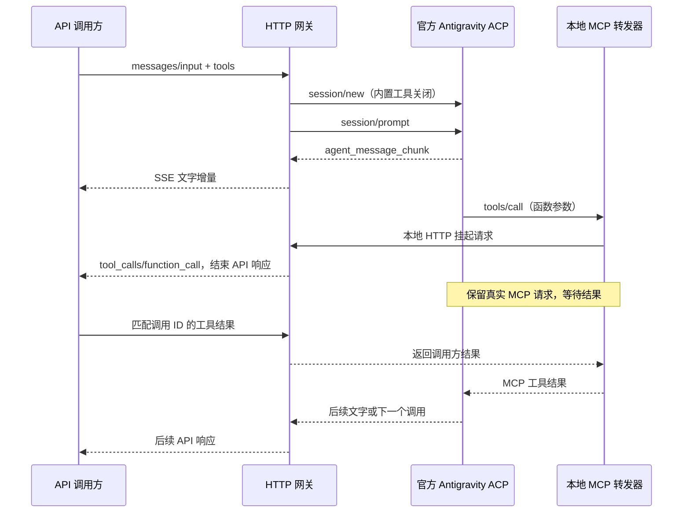

# 架构

## 模块

- `src/normalize.js`：白名单参数校验、格式归一化、工具 schema 编译。
- `src/acp.js`：官方子进程与 stdio JSON-RPC、权限决策、终止进程组。
- `src/bridge.js` / `src/mcp-helper.js`：每会话独立的本地端口、随机凭证、真实挂起的 MCP 调用。
- `src/sessions.js`：会话、精确历史匹配、调用 ID、串行交付、超时与资源释放。
- `src/formats.js`：三种 JSON / SSE 输出结构、背压处理、用量可用性标签。
- `src/server.js`：鉴权、HTTP 路由、取消和统一错误处理。
- `scripts/setup.js`：下载固定的官方发行包，仅提取两个固定根文件名。

## 内置工具关闭

每次 `session/new` 发送 `_meta: { agy: { enabledTools: [] } }`。同时在 ACP 初始化时声明文件读写和终端能力为 false。文件、终端等客户端 RPC 也直接拒绝。权限请求只允许已声明工具、MCP 服务器名为 `api` 的调用。

不声明外部工具时，实际模型请求的 tools 列表为空，已在官方运行时集成测试中验证。声明外部工具时，官方运行时仍会向模型暴露 `call_mcp_tool`、`list_resources` 和 `read_resource` 三个 MCP 管理入口。helper 只提供调用方定义的函数和空资源列表，不提供文件资源或执行命令的能力。因此“关闭内置执行工具”不意味着官方进程内部不存在任何 MCP 协议操作。

工具 schema 通过 MCP manifest 和用户提示中的 manifest 提供给官方 agent。它不是向原生模型 API 原样提交调用方的 `tools` 字段。JSON Schema 另在网关收到真实 MCP 调用时验证。

独立 `GEMINI_HOME` 和空工作目录避免混入现有用户项目的 MCP/规则配置；这不属于 OS 容器隔离。官方进程仍以当前用户身份运行，维护者修改 `.state` 内的配置可能改变行为。

## 为什么每次只交出一个调用

ACP 的工具通知、MCP 实际调用与底层模型的一批 function calls 不共享一个可靠的“这批结束”信号。官方运行时还可能在同一批中串行发起 MCP 调用：第一个得到结果之后才调用第二个。

因此网关以真实 MCP 请求到达作为边界：交付一个，等待调用方结果，再继续接收。集成测试让模拟模型一次生成两个 function calls，确认两个调用分别经过两次 API 响应，最后两个真实结果都回到模型。

## 生命周期

每个会话拥有独立官方进程、helper、工作目录和随机内部凭证。请求和调用 ID 按网关 key 隔离。会话初始化预留容量，避免并发绕过最大数量；关闭服务会等待正在初始化的会话清理完成。

关闭时先取消并终止 agent 进程组，再释放 MCP 挂起请求，避免一个自动生成的失败结果触发额外推理。重复提交、伪造或过期结果均明确失败。请求断线、超时、agent 异常退出、超大输出也会清理相关会话。

响应历史和调用 ID 不落盘。Responses 的 `store` 只控制本地内存响应缓存，并不改变 Google 的数据处理。状态丢失后不能靠一组旧 ID 恢复模型的等待点。

## 固定运行时版本

网关仅接受 `agentInfo.name=antigravity-acp` 且版本为 `1.2.1` 的握手；这是一项兼容性检查，不是对第三方二进制的真实性认证。安装器通过官方 HTTPS 地址下载，记录 SHA-256 用于复现；未进行独立发布签名验证。

升级官方运行时前，需要重新验证 metadata、工具权限、真实模型请求工具集合、错误文本包装和多调用行为。不得只改版本字符串后宣称同样兼容。
